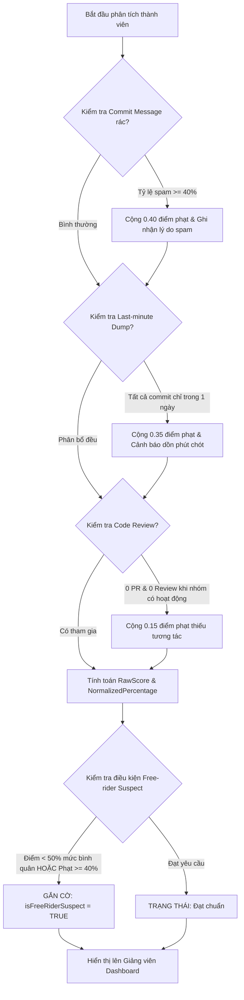
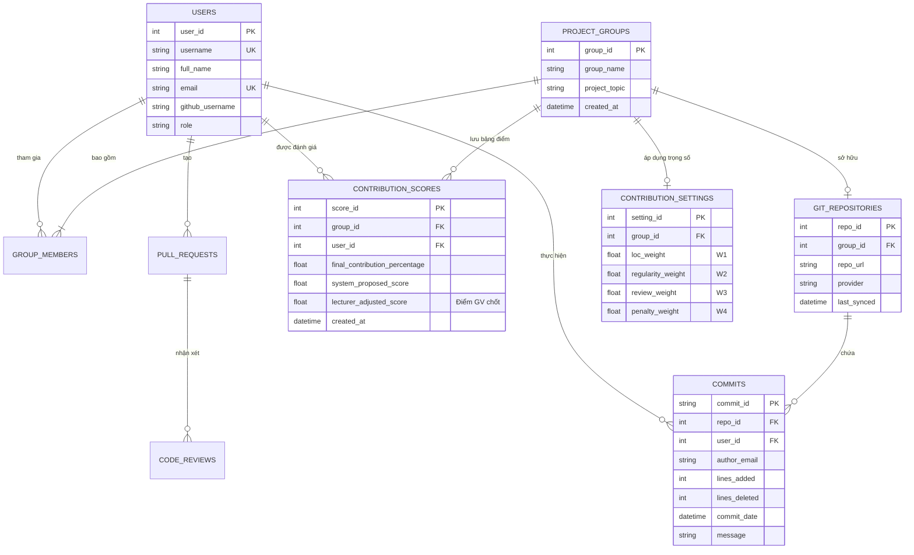
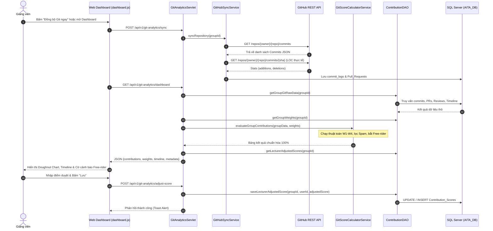

# BÁO CÁO KỸ THUẬT CHUYÊN SÂU: PHÂN HỆ GIT ANALYTICS TEAMWORK ASSESSOR (FE-L-03)
## DỰ ÁN HỆ THỐNG TRỢ LÝ GIẢNG DẠY AITA (AI-POWERED TEACHING ASSISTANT)
**Học phần:** PRJ301 - Java Web Application Development  
**Lớp học phần:** SE20C | **Giảng viên hướng dẫn:** ThS. Nguyễn Văn Vịnh  
**Nhóm chuyên môn (RBL):** Nhóm 5 - Git Analytics Teamwork Assessor  
**Mã tính năng nghiệp vụ:** `FE-L-03` (Lecturer Feature 03: Đánh giá đóng góp cá nhân & Chống Free-riding)

---

## I. TỔNG QUAN ĐỀ TÀI & GIÁ TRỊ CỐT LÕI (VALUE PROPOSITION)

### 1. Vấn đề thực tế (Problem Statement)
Trong các môn học công nghệ phần mềm và lập trình dự án (PRJ301, SWP391), hiện tượng **"Free-riding"** (thành viên ỷ lại, người làm thay cho cả nhóm hoặc chỉ làm tượng trưng vào phút chót) là một trong những nguyên nhân chính gây ra bất công trong chấm điểm và làm gia tăng tình trạng kiệt sức (**Teacher Burnout**) của giảng viên khi phải rà soát hàng ngàn commit thủ công.

### 2. Sứ mệnh của Nhóm 5 trong Hệ sinh thái AITA
Theo phân rã 7 hướng nghiên cứu RBL (Research-Based Learning) của dự án AITA, **Nhóm 5** đảm nhiệm vai trò:
> **"Định lượng hóa sự công bằng, tự động đề xuất điểm đóng góp dựa trên lịch sử Git để triệt tiêu tình trạng Free-riding."**

### 3. Mục tiêu đạt được
- **Tự động hóa 100%** việc trích xuất và phân tích lịch sử Git từ GitHub REST API.
- Đánh giá đóng góp cá nhân qua mô hình 4 chiều: **Khối lượng (Volume)**, **Tần suất (Frequency)**, **Tương tác nhóm (Review/PR)** và **Hệ số phạt (Penalty)**.
- Tự động gắn cờ cảnh báo các thành viên nghi vấn Free-rider hoặc gian lận commit spam.
- Cung cấp giao diện trực quan cho Giảng viên tùy chỉnh trọng số ($W_1, W_2, W_3, W_4$) và chốt điểm số công bằng cuối cùng.

---

## II. KIẾN TRÚC MÔ HÌNH TOÁN HỌC & THUẬT TOÁN ĐỊNH LƯỢNG

### 1. Công thức tính điểm tổng hợp có trọng số
Điểm thô ($RawScore_i$) của sinh viên $i$ trong nhóm được tính theo phương trình:

$$\text{RawScore}_i = \left( W_1 \times \frac{\text{LOC}_i}{\sum \text{LOC}} \right) + \left( W_2 \times \frac{\text{Reg}_i}{\sum \text{Reg}} \right) + \left( W_3 \times \frac{\text{Rev}_i}{\sum \text{Rev}} \right) - \left( W_4 \times \text{Penalty}_i \right)$$

*Trong đó:*
- **$W_1$ (Volume Weight - Mặc định 0.35):** Trọng số dòng mã nguồn thực chất ($\text{Lines Added} - \frac{\text{Lines Deleted}}{3}$).
- **$W_2$ (Frequency Weight - Mặc định 0.25):** Độ đều đặn dựa trên số ngày commit phân bổ qua các tuần, tránh việc dồn toàn bộ bài vào ngày cuối cùng.
- **$W_3$ (Review Weight - Mặc định 0.25):** Tương tác nhóm qua Pull Requests ($1\text{ PR} = 2\text{ review points}$) và Code Reviews.
- **$W_4$ (Penalty Weight - Mặc định 0.15):** Hệ số trừ điểm nếu có hành vi tiêu cực.

### 2. Chuẩn hóa tỷ lệ đóng góp (Group Normalization)
Để đảm bảo tính công bằng tương đối giữa các thành viên, tổng điểm đóng góp của cả nhóm luôn được chuẩn hóa về đúng **$100\%$**:

$$\text{NormalizedPercentage}_i = \frac{\text{RawScore}_i}{\sum_{k=1}^{N} \text{RawScore}_k} \times 100\%$$

### 3. Thuật toán phát hiện gian lận và Free-riding


- **Bộ lọc Anti-Spam Regex:**
  ```regex
  ^(fix|update|asdf|test|abc|xyz|fix bug|update code|commit|edit|done|change|wip|temp|ok|.)[0-9!._-]*$
  ```
- **Bộ lọc Last-minute Dumper:** Nếu $Commits > 0$ nhưng số ngày commit duy nhất $\text{DistinctDays} = 1$ sát deadline, áp dụng mức phạt $35\%$.
- **Ngưỡng nghi vấn Free-rider:** Sinh viên có tỷ lệ đóng góp $< \frac{100\%}{2 \times N}$ (dưới 50% mức bình quân nhóm) hoặc có tổng điểm phạt $\ge 40\%$.

---

## III. THIẾT KẾ CƠ SỞ DỮ LIỆU & SƠ ĐỒ THỰC THỂ QUAN HỆ (ERD)

Phân hệ Git Analytics được chuẩn hóa theo dạng chuẩn 3NF trên hệ quản trị **Microsoft SQL Server**, liên kết chặt chẽ với cơ sở dữ liệu chung của AITA:



---

## IV. KIẾN TRÚC MÃ NGUỒN MVC2 & LUỒNG THỰC THI (SEQUENCE)

Hệ thống tuân thủ chặt chẽ nguyên lý **Clean Architecture / MVC2**:
- **Model:** `GitScoreCalculatorService.java`, `GitHubSyncService.java`, `ContributionDAO.java`, `ContributionScoreDAO.java`, `UserDAO.java`.
- **View:** `index.html`, `index.jsp`, `dashboard.js`, `styles.css` (biểu đồ Chart.js, Modal tương tác).
- **Controller:** `GitAnalyticsServlet.java` (xử lý routing RESTful API).

### Sơ đồ tuần tự: Đồng bộ GitHub & Tự động Đánh giá


---

## V. TÍCH HỢP AI & TRỢ LÝ SƯ PHẠM (PEDAGOGICAL GUIDANCE)

Phân hệ tích hợp 2 lớp AI chuyên sâu:
1. **AI Heuristic Assessor:** Tự động tính toán mẫu hình phân bổ commit, trích xuất đặc trưng tin nhắn commit và gán nhãn Free-rider thông qua ma trận trọng số thích ứng.
2. **AI Pedagogical Socratic Assistant (`PedagogicalGuidanceService.java`):**
   - Hỗ trợ gọi trực tiếp **Google Gemini API** (`gemini-1.5-flash`) hoặc **OpenAI API** (`gpt-3.5-turbo`) thông qua Prompt Engineering theo phương pháp Socratic.
   - Khi chạy ngoại tuyến hoặc trong môi trường Docker Sandbox không kết nối mạng, hệ thống tự động kích hoạt bộ máy phân tích mẫu lỗi nội bộ (Pattern Matcher bóc tách `cannot find symbol`, `incompatible types`, `nullpointerexception`, `resource exceeded`...).

---

## VI. BỘ CÂU HỎI & HƯỚNG DẪN TRẢ LỜI BẢO VỆ ĐỒ ÁN (DEFENSE Q&A)

| Câu hỏi phản biện thường gặp của Giảng viên | Hướng trả lời chuẩn xác | Vị trí mã nguồn |
| :--- | :--- | :--- |
| **Q1: "Làm thế nào để hệ thống ngăn chặn việc sinh viên tạo hàng chục commit 'fix', 'update' để gian lận số lượng?"** | *"Dạ thưa thầy/cô, hệ thống sử dụng Regex nhận diện commit vô nghĩa tại `GitScoreCalculatorService.isSpamCommitMessage()`. Nếu tỷ lệ commit rác $\ge 40\%$, sinh viên sẽ bị áp dụng điểm phạt (W4 Penalty) lên tới 40%, làm giảm mạnh tổng điểm thay vì được tăng điểm."* | [`GitScoreCalculatorService.java`](file:///C:/GitHub/Nhom6_PRJ/Nhom6_PRJ/src/main/java/com/aita/gitanalytics/service/GitScoreCalculatorService.java#L25) |
| **Q2: "Nếu sinh viên làm cả tuần không commit mà dồn hết toàn bộ code vào đêm cuối trước deadline thì sao?"** | *"Hệ thống kiểm tra `distinctDays` trong lịch sử commit. Nếu sinh viên có commit nhưng toàn bộ chỉ diễn ra trong 1 ngày duy nhất (`isLastMinuteDumper = true`), thuật toán tự động phạt $35\%$ điểm và gắn cờ cảnh báo 'Phát hiện dồn toàn bộ code vào sát deadline'."* | [`ContributionDAO.java`](file:///C:/GitHub/Nhom6_PRJ/Nhom6_PRJ/src/main/java/com/aita/gitanalytics/dao/ContributionDAO.java#L177) |
| **Q3: "Làm sao hệ thống lấy được số dòng code (LOC) thực tế từ GitHub API?"** | *"Trong `GitHubSyncService`, ngoài việc lấy danh sách commit tổng quát, service còn gọi endpoint chi tiết `/commits/{sha}` để bóc tách object `stats` chứa chính xác số dòng thêm (`additions`) và số dòng xóa (`deletions`), hỗ trợ token PAT để nâng giới hạn lên 5000 request/giờ."* | [`GitHubSyncService.java`](file:///C:/GitHub/Nhom6_PRJ/Nhom6_PRJ/src/main/java/com/aita/gitanalytics/service/GitHubSyncService.java#L380) |
| **Q4: "Nếu AI đề xuất điểm không hợp lý thì Giảng viên can thiệp thế nào?"** | *"Giảng viên có 2 cách can thiệp: Một là mở Modal 'Cấu hình trọng số' để điều chỉnh lại W1-W4 cho phù hợp với đặc thù dự án; Hai là nhập trực tiếp điểm chốt tại cột 'Điểm GV chốt (%)' trên bảng Dashboard. Điểm này sẽ ghi đè và lưu vào cơ sở dữ liệu qua API `/adjust-score`."* | [`GitAnalyticsServlet.java`](file:///C:/GitHub/Nhom6_PRJ/Nhom6_PRJ/src/main/java/com/aita/gitanalytics/servlet/GitAnalyticsServlet.java#L145) |

---

## VII. DANH MỤC TỆP TIN ĐÃ THỰC THI CHO NHÓM 5

- **Core Scoring Algorithm:** [`GitScoreCalculatorService.java`](file:///C:/GitHub/Nhom6_PRJ/Nhom6_PRJ/src/main/java/com/aita/gitanalytics/service/GitScoreCalculatorService.java)
- **GitHub REST API Client:** [`GitHubSyncService.java`](file:///C:/GitHub/Nhom6_PRJ/Nhom6_PRJ/src/main/java/com/aita/gitanalytics/service/GitHubSyncService.java)
- **Data Access Objects:** [`ContributionDAO.java`](file:///C:/GitHub/Nhom6_PRJ/Nhom6_PRJ/src/main/java/com/aita/gitanalytics/dao/ContributionDAO.java) | [`ContributionScoreDAO.java`](file:///C:/GitHub/Nhom6_PRJ/Nhom6_PRJ/src/main/java/com/aita/gitanalytics/dao/ContributionScoreDAO.java)
- **REST Controller Servlet:** [`GitAnalyticsServlet.java`](file:///C:/GitHub/Nhom6_PRJ/Nhom6_PRJ/src/main/java/com/aita/gitanalytics/servlet/GitAnalyticsServlet.java)
- **AI Socratic Guidance Tutor:** [`PedagogicalGuidanceService.java`](file:///C:/GitHub/Nhom6_PRJ/Nhom6_PRJ/src/main/java/com/aita/gitanalytics/service/PedagogicalGuidanceService.java)
- **Frontend Dashboard View:** [`index.html`](file:///C:/GitHub/Nhom6_PRJ/Nhom6_PRJ/src/main/webapp/index.html) | [`dashboard.js`](file:///C:/GitHub/Nhom6_PRJ/Nhom6_PRJ/src/main/webapp/js/dashboard.js)
- **Automated Test Suite:** [`GitScoreCalculatorServiceTest.java`](file:///C:/GitHub/Nhom6_PRJ/Nhom6_PRJ/src/test/java/com/aita/gitanalytics/service/GitScoreCalculatorServiceTest.java)
- **Database Full Setup Script:** [`init_full_database.sql`](file:///C:/GitHub/Nhom6_PRJ/Nhom6_PRJ/database/init_full_database.sql)
